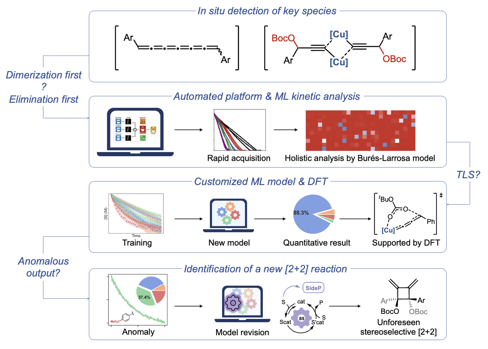

# COSORK: Classification of Substrate Orders in Reaction Kinetics

Code for *Machine-Learning Assisted Mechanistic Studies on Condensation
Polymerization of Propargylic Electrophiles*.



## Installation

Run the following commands from this project directory:

```bash
conda env create -f environment.yml
conda activate cosork
python -m ipykernel install --user --name cosork --display-name "Python (cosork)"
```

Select the `cosork` kernel for the notebooks. The environment keeps the main v1
versions: Python 3.10, AutoGluon 1.1.1, tsfresh 0.20.1, catch22 0.4.4 and tsai
0.3.9. Use the existing environment if it is already installed. CPU operation
is supported; a full CUDA development toolkit is not required.

## Generate synthetic data

```bash
python solve_ivp_synthetic.py --class_num 4 --job_num 600000 --num_proc 24 --seed 42
python solve_ivp_synthetic.py --class_num 5 --job_num 400000 --num_proc 24 --seed 42
```

The first command generates the no-k4 cycle pool used for S1–S4. The second
generates a pool with the first-order side reaction, used for S5. Five-class
preparation needs both pools. Raw pool sizes are not per-class counts.
Each accepted trajectory is saved as one JSON. Progress and ETA are written
to the console and `generation.log` in the raw directory; `--log_interval`
counts processed parameter proposals.

The generator samples all five cycle rate constants from the decade-discrete
prior and integrates the full reversible cycle with LSODA. TLS labeling is
performed afterwards. Default `--mass_mode strict` includes substrate
consumption in both Steps 1 and 3. The explicit `legacy` mode omits the Step 3
substrate debit; the notebook rejects mixed accounting modes.

To top up a pool, increase `--job_num` for the same seed/config, or use a new
seed in the same directory. `--job_num` counts accepted records for the current
seed/config, including previously saved records.

## Prepare training CSVs

Run [prepare_data_tls_pipeline.ipynb](prepare_data_tls_pipeline.ipynb) from top
to bottom. It applies threshold TLS labels, rejects ambiguous labels, samples
exactly 10,000 independent trajectories per class, splits 90/10 by trajectory,
adds Gaussian measurement noise, and extracts tsfresh Comprehensive + catch22.
It stops before writing training CSVs if any class has too few eligible samples.

The configuration cell contains the thresholds and noise settings. S5 uses a
unique S2 main-cycle label plus `0 < eta <= eta_max`, with `eta_max=1` by default;
it does not use the terminal side-product fraction phi. The threshold table
documents the implemented rule and its distinction from pure-TLS labeling.

```text
data/
├── ode_raw_data/
│   ├── 4_class/                  # one JSON per no-k4 trajectory + generation.log
│   └── 5_class/                  # one JSON per k4 trajectory + generation.log
├── 4_class/
│   ├── train_val.csv             # 36,000 rows
│   ├── test.csv                  # 4,000 rows
│   ├── train_val_tsfresh_feat.csv
│   └── test_tsfresh_feat.csv
└── 5_class/
    ├── train_val.csv             # 45,000 rows
    ├── test.csv                  # 5,000 rows
    ├── train_val_tsfresh_feat.csv
    └── test_tsfresh_feat.csv
```

Raw training tables contain `id`, `s0`–`s29`, `p0`–`p29`, and `class`. Labeling
metadata and rate constants are excluded from model inputs. Running preparation
updates the four named CSVs in each selected directory. The final notebook cell
shows the five-class nearest-training-sample Euclidean-distance distribution.

## Train COSORK

```bash
# Main 4-class and 5-class models: best_quality, 3 hours each, CPU by default.
NUM_CPUS=24 bash ag_train.sh

# Train one configuration separately.
python ag_train.py --class_num 4 --sp_mode s --feat tsfresh_raw \
    --ag_train_quality best_quality --hours 3.0 --num_cpus 24 \
    --num_gpus 0 --evaluate_on_test_data

python ag_train.py --help
```

`--feat` accepts `raw`, `tsfresh`, or `tsfresh_raw`; `--sp_mode` accepts `s`, `p`,
or `sp`. IDs are excluded from learning. The held-out test set is used only for
post-training evaluation. Evaluation prints accuracy, ROC-AUC, MCC, F1,
precision and recall, and saves `confusion_matrix.png` inside the model folder.

Default model path (matching the existing inference and analysis notebooks):

```text
AutogluonModels/{4,5}_class/tsfresh_raw_feat__s__best_quality__3.0h/
```

Existing model folders are not overwritten. If a model is already present,
train a new model using `--model_dir /path/to/new_model` and set the model path
in the inference/analysis notebook accordingly. `--data_dir` can similarly
select a different prepared dataset. Random seeds initialize Python, NumPy and
PyTorch; bit-identical AutoGluon results across hardware are not guaranteed.

For feature/time comparisons, `RUN_BENCHMARKS=1 bash ag_train.sh` runs the main
models plus raw-only, tsfresh-only, and 1/2-hour combined-feature models. This
is a full batch for new model directories; use individual commands for models
not yet trained if some configurations already exist.

## Analysis and experimental inference

| File | Purpose |
|---|---|
| `ag_result_analysis.ipynb` | Test-set metrics, confusion plots, data-size training and feature/time comparisons |
| `ag_experiments.ipynb` | Experimental curve preprocessing, feature extraction, four/five-class inference and plots |
| `feat_importance.py` | Five-class feature importance; may run for many hours |
| `benchmark_tsai.ipynb` | Time-series deep-learning benchmarks |
| `experimental_data/data.csv` | Experimental kinetics |
| `experimental_data/single_data.csv` | Input example for a single experimental trace |
| `Bures_model_prediction/` | Bures-model scripts and their separate environment file |

Feature/time comparison cells require the corresponding trained models; saved
notebook figures alone are not evidence of a new run. After regenerating data,
retrain the corresponding model before reporting results for that dataset.

`download_data_and_model.sh` is the existing archive-download helper. It extracts
into `data/` and `AutogluonModels/`; use it in a clean copy when retrieving archived
results. The downloads are an alternative to local regeneration, not an automatic
match to a newly selected TLS configuration.

**Public archives (checked 2026-09-15):** both records are open-access and their
file URLs return HTTP 200 without authentication:

- [Training data — Zenodo 22720303](https://doi.org/10.5281/zenodo.22720303):
  `data.tar.gz` (564,249,498 bytes; MD5 `dde11e68369e1d29a23a880a311ac55e`).
- [Trained models — Zenodo 22720378](https://doi.org/10.5281/zenodo.22720378):
  `AutogluonModels.tar.gz` (2,918,068,490 bytes; MD5 `b658f5a2a6091d9508ce58496abc4909`).

Availability and record metadata were verified; the full archives were not
downloaded for this check. The helper rejects HTML responses, invalid archives
and existing target directories. Alternative links can be supplied as `DATA_URL`
and `MODEL_URL`.

For Bures-model analysis, create its separate environment with
`conda env create -f Bures_model_prediction/bures_environment.yml`, activate
`org_mech`, and register/select that environment as the notebook kernel.
Run `Bures_model_prediction/generate_predict_analyze_data.ipynb` from its own
directory. Its generation cells recreate `Data/all_data/`; the batch script
creates `all_data_output/` and `all_data_plot/` when needed. This historical
TensorFlow environment is separate from the main AutoGluon environment.

## GitHub source contents

Git excludes generated `data/`, `AutogluonModels/`, `tsai_Models/`, Python caches,
logs, partial files, and per-combination Bures intermediates. Experimental CSVs,
the workflow image, Bures source data/model/images, aggregate results and
notebook figures are included. Saved figures are historical snapshots; optional
benchmark cells require additional trained models and are not a clean-clone
run-all workflow. The main preparation notebook runs all its stages after the
raw JSON pools have been generated.

Before publishing archived numerical claims, verify that the selected data,
model and TLS configuration belong to the same run.
Source-code syntax checks and small integration tests do not establish that
the current generator reproduces previously reported manuscript metrics.

## License

MIT; see [LICENSE](LICENSE). This workflow uses AutoGluon, tsfresh, catch22,
tsai, scikit-learn, SciPy, pandas, matplotlib and seaborn.
