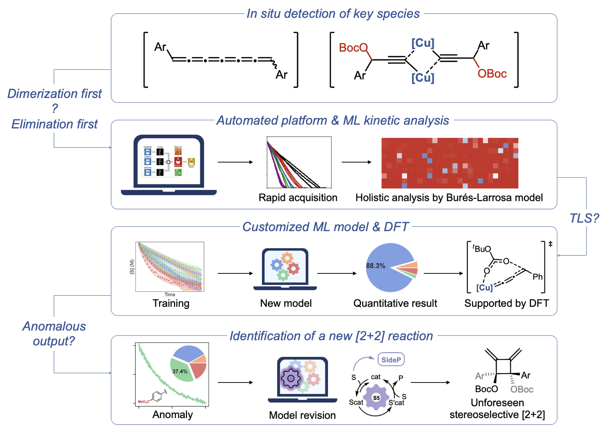

# COSORK: Classification of Substrate Orders in Reaction Kinetics

Code for *Machine-Learning Assisted Mechanistic Studies on Condensation Polymerization of Propargylic Electrophiles*.



## Installation

```bash
conda env create -f environment.yml
conda activate cosork
python -m ipykernel install --user --name cosork --display-name "Python (cosork)"
```

Select the `cosork` kernel and run notebooks from the project directory. The environment specifies Python 3.10, AutoGluon 1.1.1 and tsfresh 0.20.1. CPU execution is supported.

## Data and saved models

- [COSORK datasets on Zenodo](https://doi.org/10.5281/zenodo.22720303): `data.tar.gz`.
- [COSORK models on Zenodo](https://doi.org/10.5281/zenodo.22720378): `AutogluonModels.tar.gz`.

Run `bash download_data_and_model.sh` in a clean checkout to download both archives. The helper creates `data/` and `AutogluonModels/` and refuses to overwrite existing directories. The large COSORK datasets and models are distributed through Zenodo.

## Generate and prepare synthetic data

```bash
python solve_ivp_synthetic.py --class_num 4 --job_num 600000 --num_proc 24 --seed 42
python solve_ivp_synthetic.py --class_num 5 --job_num 400000 --num_proc 24 --seed 42
```

The generator integrates the reversible cycle with LSODA, sampling the five cycle rate constants independently. The four-class pool has no side reaction; the five-class pool includes it. Raw JSON trajectories are written to `data/ode_raw_data/4_class/` and `data/ode_raw_data/5_class/`. Progress and ETA appear in the console and `generation.log`; `--log_interval` counts processed parameter proposals.

Pool sizes count raw trajectories, not accepted samples per class. Increase `--job_num` or add another seed when filtering leaves too few samples, especially for S5.

Run [prepare_data_S1_S5.ipynb](prepare_data_S1_S5.ipynb) for posterior labeling, random sampling, Gaussian measurement noise, a 90/10 train/test split, tsfresh/Catch22 features, and the Euclidean-distance distribution. Set `CLASS_NUMS` to `[4]`, `[5]`, or `[4, 5]`; use a new `OUTPUT_ROOT` when preparing another dataset.

With normalized initial concentration equal to one, define `s_star = k2/min(k1,k3)` and the trajectory interval `[s_low,s_high]` from the sampled concentrations.

| Class | Selection criterion |
|---|---|
| S1 | `s_star <= s_low` |
| S2 | `s_low < s_star < s_high` and `k1 <= k3` |
| S3 | `s_star >= s_high` and `k1 <= k3` |
| S4 | `s_low < s_star < s_high` and `k3 < k1` |
| S5 | Side-pool cycle-S2 trajectory with `0.02 <= bp[-1]/(p[-1]+bp[-1]) < 0.5` |

The generation-time 5% speed filter does not set the labeling interval. Each class contributes 10,000 eligible trajectories. The notebook checks coverage before writing output.

Each `data/4_class/` or `data/5_class/` directory contains:

- `train_val.csv` and `test.csv`: concentration points, sample ID and class label.
- `train_val_tsfresh_feat.csv` and `test_tsfresh_feat.csv`: extracted features aligned by ID.

Rate constants and labeling quantities are excluded from predictor features.

## Train and use COSORK

```bash
NUM_CPUS=24 bash ag_train.sh
# Or train one configuration into a new directory:
python ag_train.py --class_num 5 --sp_mode s --feat tsfresh_raw \
  --ag_train_quality best_quality --hours 3.0 --num_cpus 24 \
  --num_gpus 0 --evaluate_on_test_data --model_dir new_5class_model
```

`--data_dir` selects another prepared dataset. Existing model directories are protected from overwriting. The supplied inference notebooks use `AutogluonModels/{4,5}_class/tsfresh_raw_feat__s__best_quality__3.0h/`; update the path when using another model.

| File | Purpose |
|---|---|
| `ag_experiments.ipynb` | Experimental preprocessing, features, four/five-class prediction, and plots |
| `ag_result_analysis.ipynb` | Test-set analysis and optional model-size/feature/time comparisons |
| `feat_importance.py` | Permutation feature importance |
| `benchmark_tsai.ipynb` | Time-series deep-learning benchmarks |
| `experimental_data/` | Experimental concentration–time inputs |

Benchmark and feature-importance calculations can be time-consuming; optional comparisons require their corresponding trained models. Regenerated datasets can be used with the training entry point to build new models.

## Traditional kinetic analysis: SI Table S13

[traditional_kinetic_analysis/](traditional_kinetic_analysis/) contains the experimental input, processing settings, fitting code, parameter estimates, residuals, sensitivity results, and Table S13. It compares S1–S5 using generalized least squares (GLS), centred R², and the corrected Akaike information criterion (AICc).

```bash
cd traditional_kinetic_analysis
python code/check_numerics.py
python run_analysis.py --out rerun_results --workers 4
# Regenerate plots from the supplied results/:
python plot_and_validate.py
```

The analysis can also run separately using `pip install -r requirements.txt` inside that folder. The full calculation includes 42 processing configurations and 5,600 bootstrap replicates. Results are conditional on the specified processing and error model; the sensitivity outputs are supplied alongside the primary results.

Key files:

- [Table S13(a): centred GLS R²](traditional_kinetic_analysis/results/Table_S13a_centered_GLS_R2.csv)
- [Table S13(b): ΔAICc](traditional_kinetic_analysis/results/Table_S13b_delta_AICc.csv)
- [Parameter estimates](traditional_kinetic_analysis/results/parameter_estimates.csv)
- [Fits and residual plots](traditional_kinetic_analysis/all_substrates_fits_and_diagnostics.pdf)
- [Detailed analysis instructions](traditional_kinetic_analysis/README.md)

## Burés-model analysis

Create its separate environment with `conda env create -f Bures_model_prediction/bures_environment.yml`. Run `Bures_model_prediction/generate_predict_analyze_data.ipynb` from that directory using the `org_mech` kernel. The pretrained model and required source files are included.

## License

MIT; see [LICENSE](LICENSE).
